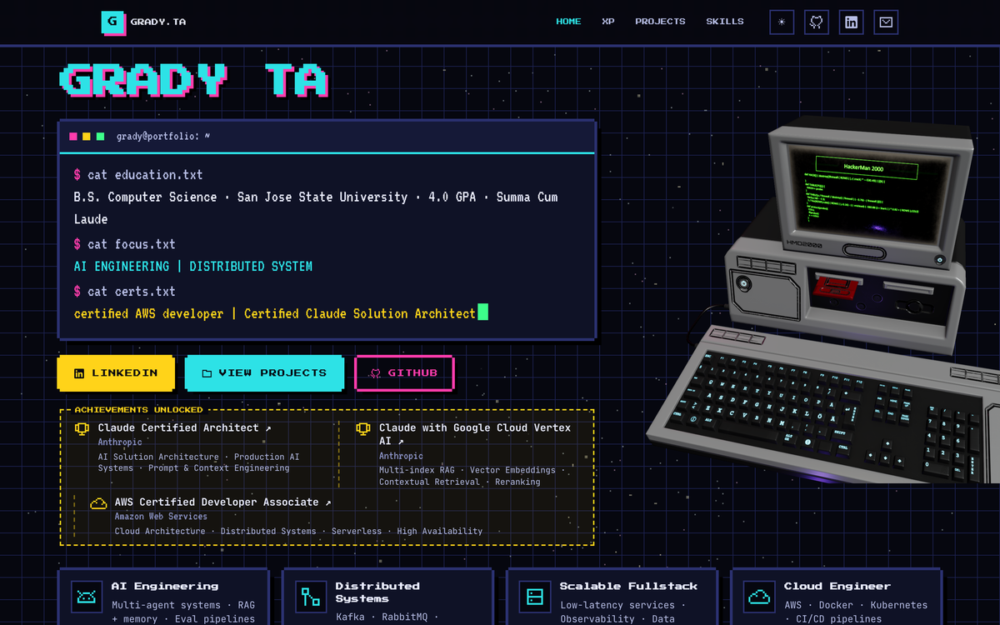
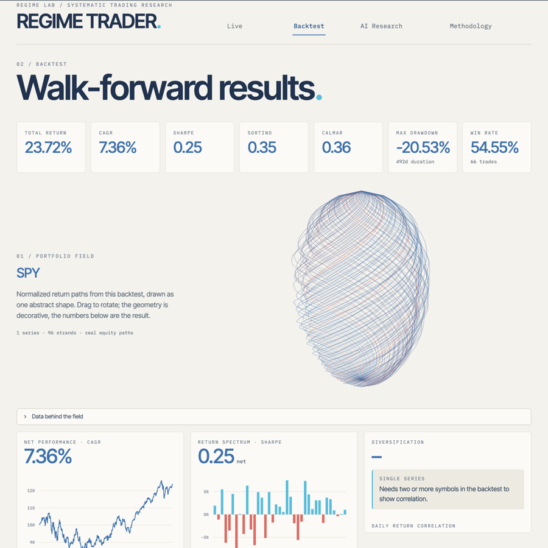
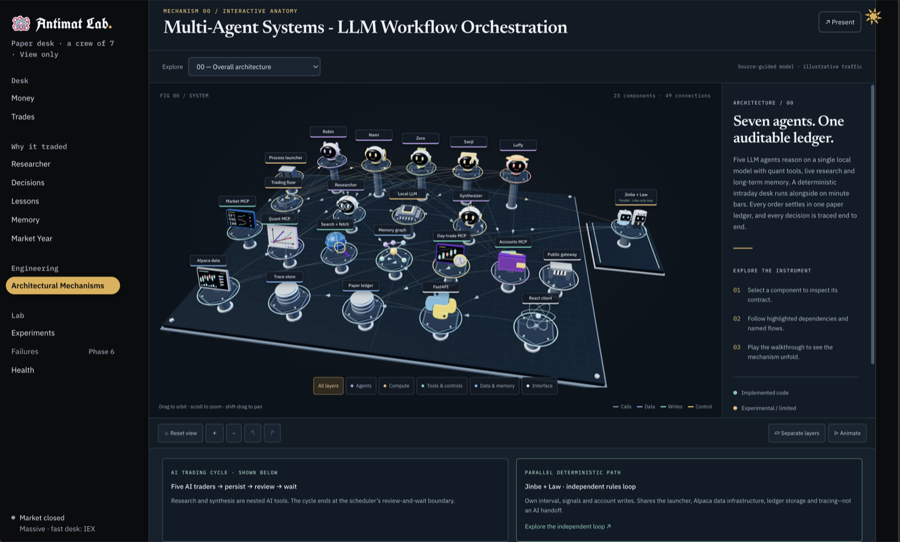
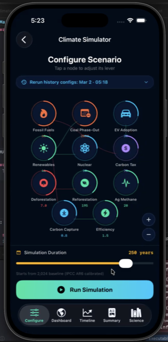

<div align="center">


<a href="https://gradyta.netlify.app" target="_blank">
  
</a>

[](https://gradyta.netlify.app)
[](https://linkedin.com/in/gradyta)

[](https://www.credly.com/badges/0f20f909-1261-41d9-8f72-19d166a7cffd)
[](https://verify.skilljar.com/c/ki5ysg7rpwq2)
[](https://www.credly.com/badges/e10e0709-a7df-4f76-8649-9c6f5a7a307e/linked_in_profile)

</div>

```console
grady@github:~$ cat about.txt
  role      Software Engineer @ Centric Software (Dassault Systèmes)
  focus     AI engineering | distributed system
  certs     Claude Certified Architect · Claude with Google Cloud Vertex AI
            AWS Certified Developer Associate
  edu       B.S. Computer Science, San Jose State University — 4.0 GPA, Summa Cum Laude
  motto     Stay curious, furious, to be meritorious.
```

---

## `> cat certs.txt`

| | Certification | Issuer | Skills |
|---|---|---|---|
| 🏆 | **[Claude Certified Architect](https://www.credly.com/badges/0f20f909-1261-41d9-8f72-19d166a7cffd)** | Anthropic · 2026–2027 | AI Solution Architecture · Production AI Systems · Prompt & Context Engineering |
| 🏆 | **[Claude with Google Cloud Vertex AI](https://verify.skilljar.com/c/ki5ysg7rpwq2)** | Anthropic · 2026 | Multi-index RAG · Vector Embeddings · Contextual Retrieval · Reranking |
| ☁️ | **[AWS Certified Developer – Associate](https://www.credly.com/badges/e10e0709-a7df-4f76-8649-9c6f5a7a307e/linked_in_profile)** | Amazon Web Services · 2026–2028 | Cloud Architecture · Distributed Systems · Serverless · High Availability |

---

## `> ls ./projects --featured`

### ▸ [AI Auto Trader → Robinhood](https://github.com/ggmaddr/automate-ml-trading-hidden-markov) &nbsp;`Jul 2026 — Present`




**Automated trading system for Robinhood** with LLM agents, Hidden Markov Models and real-time market data
- RAG + long-term agent memory across market research with vector embeddings and reranking
- Multi-agent orchestration — research and execution agents behind **safety guardrails**
- AI observability with model/agent telemetry and **130+ pytest** unit tests

### ▸ [Autonomous Traders Lab](https://github.com/ggmaddr/Autonomous-Traders-Lab)




**Multi-agent AI trading system** with 8 collaborative AI agents under MCP
`37% better decisions` · `55% cost reduction` · `4× faster execution (0.6s)` · `99.9% uptime`

### ▸ [SimEarth — iOS Climate Science Simulator](https://github.com/ggmaddr/Stochastic-Earth-Climate-Simulator)




Interactive climate simulator inferring the impact of **11 policy levers** (carbon tax, EV adoption) on **20 climate & socioeconomic variables** (temperature, sea level, GDP) — a **stochastic Markov chain engine** with 4 feedback loops, 5 climate oscillations and 6 random external events.

### ▸ [Galleria Heist](https://github.com/ggmaddr/Galleria-Heist-iOS-gamePlaykit)


Premium iOS mind-twist game — recover a diamond through physics-based puzzles. **GameplayKit state machine** architecture; SpriteKit rendering optimized with **node pooling, spatial collision and Bezier path generation**.

### ▸ [AR iOS Ghosts With Jobs](https://github.com/ggmaddr/iOS-Swift-AR-Ghost-Hunter-with-CoreML)


iOS AR comedy game — **Kalman-filtered motion control** for tilt, shake and rotation at 60Hz, adaptive ghost spawning state machines, CoreHaptics patterns and SwiftUI overlays.

### ▸ [MotionCoach — Advanced ML Motion Tracker](https://github.com/ggmaddr/CoreML-MotionCoach---Advanced-Activity-Tracking-App)


iOS fitness app with a CoreML activity classifier — `85% accuracy` · sensor fusion with Kalman filtering: `+50% route accuracy` · `−50% battery use`

### ▸ [ML Trash Sorting](https://github.com/realdarter/Trash-Classification)


CNN-based **ResNet-50** classifier for 5+ waste types — `98% accuracy`

<details>
<summary><b>▸ more builds</b> — Cipher Chat · A* Puzzle Solver · Real-Time Crypto · 3D FPS Shooting Legends</summary>

- **[Cipher Chat](https://github.com/ggmaddr/CipherChat)** — real-time messaging with WebSocket, GraphQL, Prisma, MongoDB and a GPT-4 bot; Three.js UI
- **[Automatic A* Puzzle Solver](https://github.com/ggmaddr/AI-Computer-Vision-Water-Puzzle-Solver-)** — OpenCV + A* robot: `≤2s solves` · `70% smaller search space` · `100% accuracy`
- **[Real-Time Crypto Tracker](https://github.com/ggmaddr/crypto-real-time)** — React + MySQL dashboard on the CoinGecko API
- **[3D FPS Shooting Legends](https://github.com/ggmaddr/3D-FPS-Shooting-Legends/tree/main)** — Unreal Engine 5 shooter with autonomous AI squads

</details>

---

## `> cat experience.log`

**▸ Centric Software** *(Dassault Systèmes)* — Software Engineer · May 2024 – Present · San Jose, CA
- AI-powered PLM platform serving **800+ global enterprise clients** (LVMH, Hermès, Balenciaga, Uniqlo, Starbucks, Under Armour)
- Query response times **7×–20× faster** for **5,000+ concurrent users**; archiving pipeline **60% faster**; recursive lookups **90% faster**
- Distributed system on RabbitMQ, Kafka and Zookeeper; CI/CD with Docker + Jenkins

**▸ Spectrum** *(Charter Communications)* — Software Engineer Intern · Feb – May 2024 · Charlotte, NC
- Enrollment and compliance records tracking for **10M+ users**

**▸ Presight.IO** — Software Engineer Intern · Jun – Sept 2023 · Seattle, WA
- Multi-agent econometric simulations for **80+ e-commerce stores**, **70% predictive accuracy** (PyMC, PyTensor, NumPy)

**▸ SuperAlign** — Software Engineer Intern · Mar – Jun 2023 · Santa Clara, CA
- Integrated finance ML models into a full-stack platform with React, REST APIs and Go

---

## `> inventory --all`

**Languages**


**AI / ML**


**Backend & Distributed Systems**


**Data, Cloud & DevOps**


**Frontend & Games**


<div align="center">


</div>
